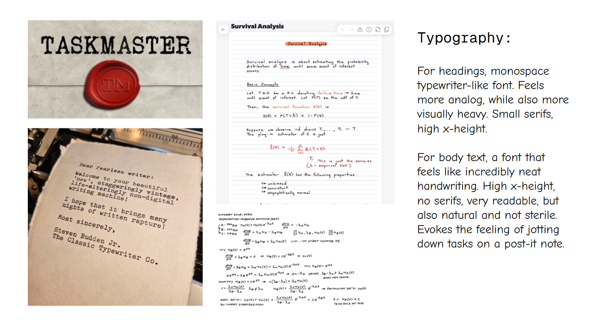
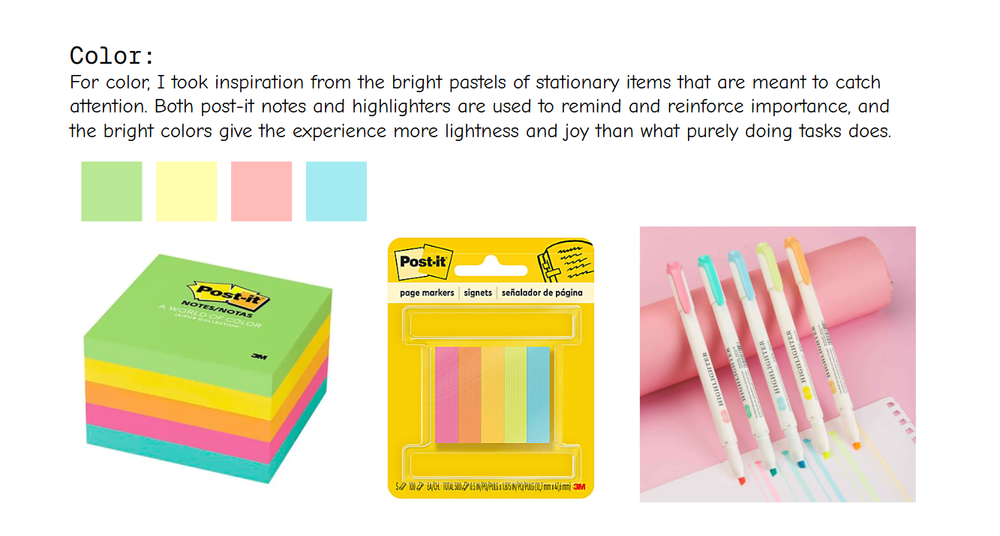

# Design Document

## Design Overview

### User Story

As Alice, a student at MIT, is walking to class one morning, she sneezes from the pollen in the air and distantly remembers that she's out of allergy medicine and should get more. With Taskmasker, Alice quickly pulls out her phone and types in "get allergy meds!!" into the Task Name field in the Add input box. She's a bit late to class, so she doesn't pause to fill in the rest of the fields.

At lunch, Alice's friend Bob sits down across from her. They start talking about a club they're both in. Alice just got elected social co-chair, and though most of the work is done, she realizes she needs to buy snacks and drinks for the social every month. So, she opens Taskmaster, adds the task, and sets it to recur every 30 days. Now, instead of trying to remember to do something once a month, Alice will see her reminder to get social supplies reappear every month without her having to do anything.

After lunch, Alice has twenty minutes with nothing on her calendar. When she opens her tasklist, she immediately feels inundated by the list of things she has to do. She tells Taskmaster how much time she has and asks it to suggest something. Looks like she'll be drafting an email before her next class instead of getting hit by the fatigue of being unable to decide and ultimately doing nothing productive instead.

When Alice gets home for the day, she wants to figure out if there's anything urgent to do. She quickly scrolls through her tasks and sees none that are highlighted red, which mean that a task is overdue. So, she selects sort by due date and sees that she needs to fill out a waiver by end of day that she had forgotten about.

## Concept Changes

My original design had three concepts: TaskListing, TaskSetting, and TaskSuggesting. During my implementation in P2, I realized that in order to implement them correctly, I had to greatly expand on these concepts. To that end, I added more logical branches to handle various invalid inputs and failures. I also added a few queries to my original concepts to aid in compositions and reactions. In P2, I also had to add the Authenticating and Sessioning concepts

For P3, I wanted to add the ability to sort and filter tasks to resolve the bad situation of being unable to find relevant tasks in a long and hard to navigate list of tasks. So, I created two new concepts--TaskSorting and TaskFiltering. I kept the comparator (for TaskSorting) and filter (for TaskFiltering) as external types, so that I could add whichever comparators and filters as I found necessary and relevant to the app.

Lastly, I found some bugs in my testing during P3 concerning recurring tasks. I tightened up the concept and implementation of recurring tasks to make sure they were not counted as active when completed. I also more clearly defined the tasks to recur on a schedule that was not dependent on time of the last task's completion.

In P4, I found that errors in running the app itself (server not started, network errors, time outs) all resulted in the same error message, which is helpful to neither the user nor the developer. So, I implemented more granular error messages.

## Visual Design

### Design Studies

For the visual aesthetic of the frontend, I wanted the app to have an analog to-do list feel, so I chose a monospace typewriter-like font for headers and a neat but somewhat handwritten font for the body text. I drew color inspiration from grade school stationary.

### Design Changes

For P2, I was mostly concerned with having a working frontend that I could use to test the concepts and compositions. So, in P3, I made a lot of visual changes to improve the design of the app.

The original agent-made frontend had issues with the concepts of proximity and grouping. When users inputted invalid data, the error message appeared at the bottom of the app instead of in the task adding section of the app. There were also issues with different sections of the app (corresponding to different concepts) not being properly separated.

Another large issue I had with the agent-made frontend design is that the suggestions, new task, and filtering groups all took up too much space, to the point where the task list itself required scrolling to get to. I heavily compressed the space these concepts took up to shift focus back onto the tasklist itself. I also compressed the vertical space each task took up, compacting all the task information to a single line, as well as making the complete, edit, and delete buttons inline. This made the entire site easier to navigate at a glance and removed unnecessary visual noise.
